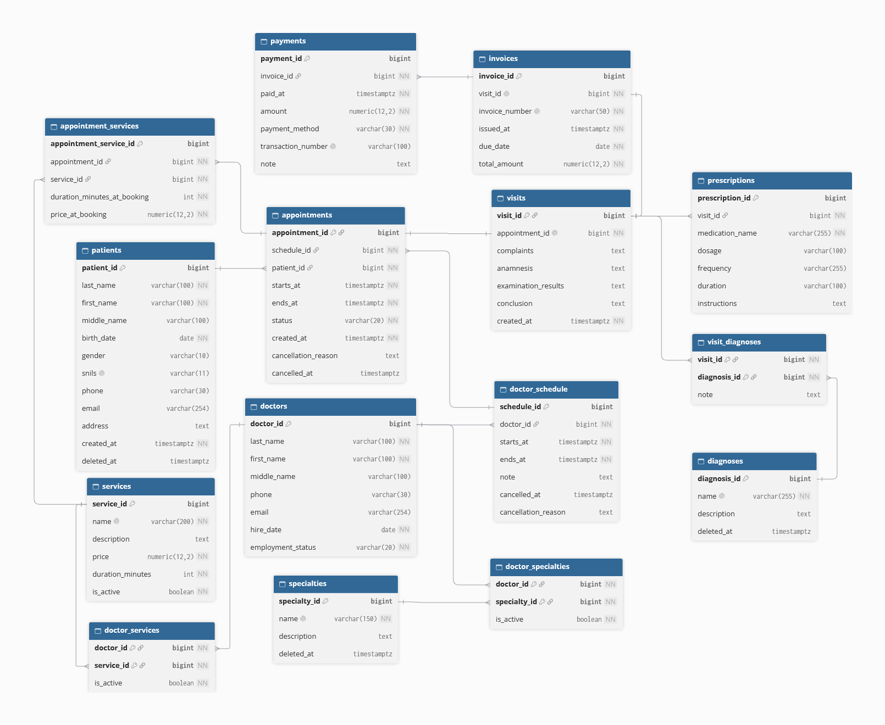

# Medical Clinic Database

Реляционная база данных многопрофильной медицинской клиники на PostgreSQL.

Проект охватывает управление пациентами, врачами, расписанием, записями на приём, медицинскими визитами и финансовыми операциями.

## ER-диаграмма



Исходная модель: [`database/diagrams/medical_clinic.dbml`](database/diagrams/medical_clinic.dbml).

## Структура проекта

```text
medical-clinic-db/
├── database/
│   ├── migrations/       # SQL-миграции 001–022
│   ├── queries/
│   │   ├── operational/  # Операционные запросы
│   │   └── analytical/   # Аналитические запросы
│   └── diagrams/
│       └── medical_clinic.dbml
├── docs/
│   └── er_diagram.png
└── README.md
```

## Бизнес-правила и целостность данных

- Записи создаются только к активным врачам и в пределах действующего рабочего интервала.
- Начало приёма соответствует 15-минутной сетке расписания.
- Пересечения записей одного врача и одного пациента запрещены.
- Отмена записи освобождает время; `no_show` сохраняет занятый интервал.
- Каждая запись содержит одну или несколько услуг.
- Цена и продолжительность услуг фиксируются на момент бронирования.
- Завершённый приём должен иметь ровно один медицинский визит.
- Для одного визита допускается не более одного счёта.
- Сумма платежей не может превышать сумму счёта.
- Медицинская и финансовая история защищена от физического удаления.
- Логическое удаление применяется к пациентам, специальностям и диагнозам.

## Функции

### Основные функции

| Функция | Назначение |
|---|---|
| `fn_get_available_appointment_slots` | Поиск свободных временных интервалов |
| `fn_book_appointment` | Создание записи с выбранными услугами |
| `fn_cancel_appointment` | Отмена записи |
| `fn_complete_appointment` | Завершение приёма и создание визита |
| `fn_mark_appointment_no_show` | Регистрация неявки пациента |
| `fn_issue_invoice` | Выставление счёта |
| `fn_register_payment` | Регистрация платежа с контролем остатка |

### Внутренние функции проверки

| Функция | Назначение |
|---|---|
| `fn_assert_active_doctor_has_service` | Проверка наличия услуг у активного врача |
| `fn_assert_active_doctor_has_specialty` | Проверка наличия специальности у активного врача |
| `fn_assert_appointment_service_total` | Проверка состава и общей продолжительности услуг |
| `fn_assert_appointment_visit_consistency` | Проверка соответствия статуса записи и визита |
| `fn_assert_invoice_payment_limit` | Проверка ограничения суммы платежей |

### Функции триггеров

**Врачи и расписание**

- `fn_check_active_doctor_service_requirement`
- `fn_check_active_doctor_specialty_requirement`
- `fn_handle_doctor_dismissal`
- `fn_validate_doctor_schedule`
- `fn_validate_doctor_service_link`
- `fn_validate_doctor_specialty_link`

**Пациенты**

- `fn_validate_patient_birth_date`

**Записи и услуги**

- `fn_check_appointment_service_total`
- `fn_check_appointment_visit_consistency`
- `fn_validate_appointment`
- `fn_validate_appointment_lifecycle`
- `fn_validate_appointment_service_line`

**Визиты**

- `fn_validate_visit_lifecycle`

**Счета и платежи**

- `fn_check_invoice_payment_limit`
- `fn_validate_invoice`
- `fn_validate_payment_record`

## Представления

| Представление | Назначение |
|---|---|
| `v_invoice_status` | Состояние счетов, суммы оплат, остатки и задолженности |

Возможные статусы: `unpaid`, `partially_paid`, `paid`, `overdue`.

## SQL-запросы

### Операционные

Каталог: `database/queries/operational/`

| Файл | Назначение |
|---|---|
| `01_doctor_schedule.sql` | Расписание врача и записи на приём |
| `02_patient_history.sql` | История записей пациента |
| `03_visit_details.sql` | Подробная информация о визите |
| `04_available_slots.sql` | Поиск свободного времени |

### Аналитические

Каталог: `database/queries/analytical/`

| Файл | Назначение |
|---|---|
| `01_appointment_statistics.sql` | Статистика приёмов и их статусов |
| `02_doctor_utilization.sql` | Загруженность врачей |
| `03_service_performance.sql` | Использование услуг и их стоимость |
| `04_diagnosis_statistics.sql` | Статистика диагнозов |
| `05_financial_summary.sql` | Финансовая сводка |
| `06_monthly_payments.sql` | Поступления по месяцам и способам оплаты |

## Демонстрационные данные

В проект включены вымышленные данные:

- 8 пациентов;
- 4 врача;
- 5 интервалов расписания;
- 12 записей на приём;
- 7 визитов;
- 4 счёта;
- 2 платежа.

## Запуск проекта

**Требования:** PostgreSQL, DBeaver Community или другой SQL-клиент.

1. Создать базу данных `medical_clinic`.
2. Подключиться к ней через SQL-клиент.
3. Последовательно выполнить миграции `database/migrations/` от `001` до `022`.
4. Запросы из `database/queries/` выполнять по отдельности по мере необходимости.

---

**Технологии:** PostgreSQL · SQL · DBML · DBeaver · Git